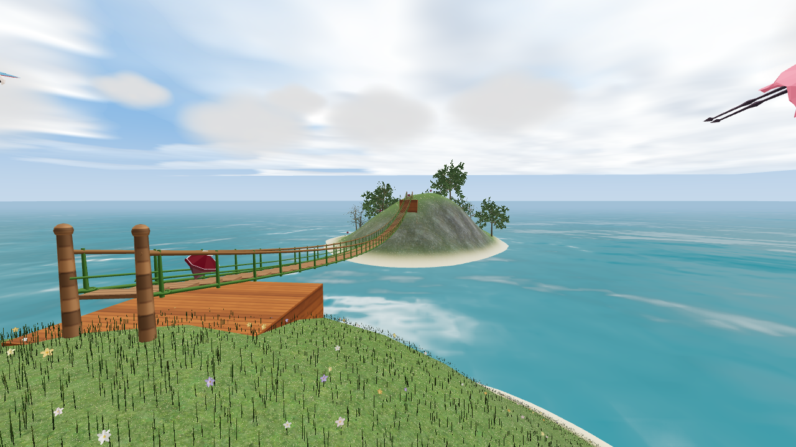

# Island FPS (Three.js + Vite)

A first-person island explorer: collect every ruby, bounce on trampolines, and wander a forest of procedural trees on two islands joined by a vine bridge.

**Play it live:** https://brerdem.github.io/game/

## Controls

- **Click** to start / capture the mouse
- **Mouse** to look around
- **WASD** or **arrow keys** to move
- **Shift** to sprint
- **Space** to jump
- **Esc** to pause / release the mouse
- Walk into a **ruby** to collect it
- Land on a **trampoline** for a super jump (the only way to reach the high gems)

The HUD shows gems collected (`n / total`), score, and a timer that starts on the first click and pauses while paused. Collect them all to win. A smaller second island sits across a short gap of sea; climb the hill and walk the rope bridge (falling off drops you in the water and respawns you on shore). Birds wander the sky. A loading screen covers startup until textures and trees are ready.

## Develop

- `npm run dev` – local dev server
- `npm run build` – Vite build to `dist/` (`base: './'`, ready for GitHub Pages)
- `node scripts/check.mjs 'http://127.0.0.1:4173/?debug' screenshot.png` – headless check + screenshot
- `node scripts/physics.mjs` – ramp / jump / shoreline physics test

URL flags: `?debug` (hide overlay, keyboard works without pointer lock), `?low` (fewer blades/trees, lower shadows), `?seed=N`, `?yaw=`, `?pitch=`

Quality also drops automatically if the frame rate stays below ~26 fps.

## Credits

See [CREDITS.md](CREDITS.md) for libraries, textures, and licenses.
